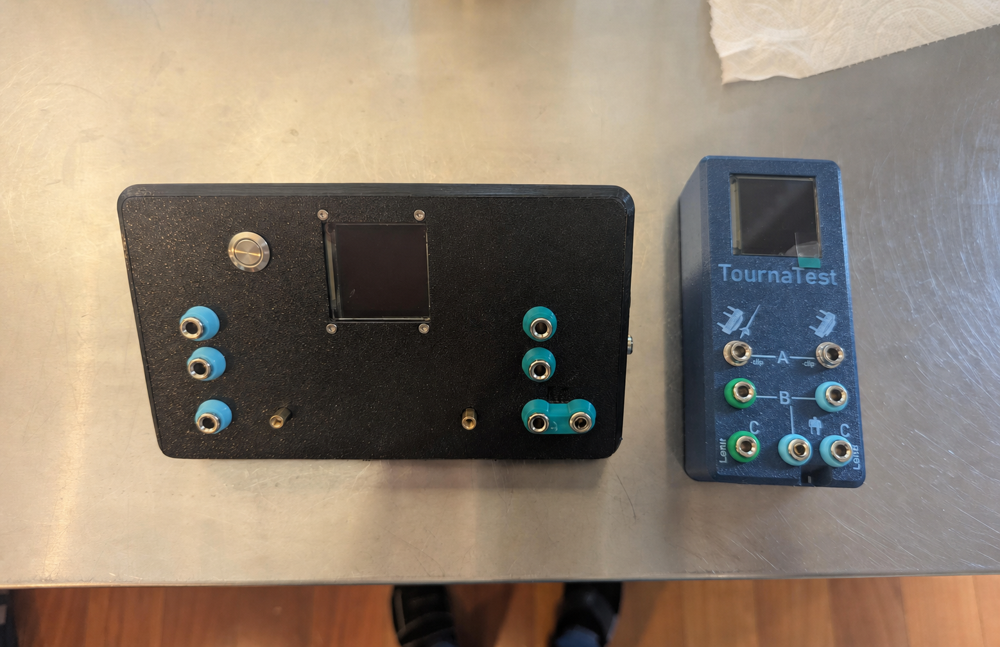

# TournaTest Digital Firmware Updater

Use this Windows updater to install firmware on a TournaTest Digital test box.



For complete instructions for using the test box, see the [TournaTest Digital User's Guide](TournaTest%20Digital%20User's%20Guide.pdf).

## Download the Updater from GitHub

1. Open this project's main GitHub page.
2. Find the green **Code** button above the file list and click it.
3. Click **Download ZIP** in the menu.
4. When the download finishes, open your **Downloads** folder.
5. Right-click the downloaded ZIP file, select **Extract All**, and then click **Extract**.
6. Open the extracted folder. It should contain `TTArmUpdate.bat`, `TTArmUpdate.ps1`, `adafruit-nrfutil.exe`, and one or more firmware ZIP files.

Do not extract the firmware files named `TTArm-buildYYYYMMDDx.zip`. The updater uses those files in ZIP form.

## What You Need

- A Windows 10 or Windows 11 computer
- A USB data cable
- A TournaTest Digital test box

Everything else needed for the update is included in the downloaded folder.

> [!IMPORTANT]
> The updater checks that a working TournaTest Digital test box is connected before starting an update. It will not update other connected devices.
>
> The updater can only update a test box that has already been programmed. It cannot program a new or replacement Adafruit Feather for the first time. This protection prevents the updater from sending TournaTest firmware to an unknown device, which could damage or disable other equipment connected to the computer.

## Update the Test Box

1. Close any serial terminal, Arduino Serial Monitor, or other program that may be using the test box.
2. Connect the test box directly to the computer with a USB data cable. The test box will automatically power on and remain on while USB is connected.
3. Wait for Windows to recognize the test box.
4. Double-click `TTArmUpdate.bat` in the extracted folder.
5. Select the newest firmware build unless you were told to use another version.
6. Select the test box's COM port.
7. Click **Connect and Update**.
8. Check the firmware filename and COM port in the confirmation message, and then continue.
9. Keep the test box connected until you see:

   ```text
   Update complete! Exit code 0.
   ```

The test box may disconnect and reconnect during the update. This is normal.

## Firmware Builds

Newest builds are listed first.

| Firmware build | Date | Main change |
|---|---|---|
| `TTArm-build20260629d.zip` | June 29, 2026 | Changes the cable-detection threshold to 1 ohm. |
| `TTArm-build20251130d.zip` | November 30, 2025 | Improves AC-short detection on affected test boxes. |
| `TTArm-build20251105d.zip` | November 5, 2025 | Adds the menu system and display improvements. |

## Finding the Correct COM Port

If only one COM port is listed, select it. If several are listed:

1. Disconnect the test box.
2. Click **Scan Ports** and note the list.
3. Reconnect the test box.
4. Click **Scan Ports** again.
5. Select the port that appeared after reconnecting the test box.

## Troubleshooting

### Windows blocks the updater

Run `TTArmUpdate.bat`, not `TTArmUpdate.ps1`. If Windows shows an **Unblock** option in the downloaded file's Properties window, select it. Only use files downloaded from a source you trust.

### No COM port appears

- Click **Scan Ports** after connecting the test box.
- Close any program that may be using the test box.
- Try a different USB port.
- Try another USB cable. Some cables provide power but do not carry data.

### The updater cannot find the test box

- Confirm that you selected the correct COM port.
- Disconnect and reconnect the USB cable, and then scan again.
- Restart the test box and retry.
- Confirm that the connected device is an already-programmed TournaTest Digital. A new or unprogrammed Feather will not pass the updater's device check.

### The test box does not power on when connected

- Disconnect and reconnect the USB cable.
- Try a different USB port.
- Try another USB data cable.
- Confirm that the battery disconnect switch is in the **On** position.

### The update fails

- Make sure all updater files and the selected firmware ZIP are in the same extracted folder.
- Do not run the updater from inside the downloaded ZIP file.
- Reconnect the test box and try again.
- Record the message and exit code shown in the updater if you need help.

## Safety

- Use only TournaTest Digital firmware supplied by a trusted source.
- Keep the computer and test box powered throughout the update.
- Do not disconnect the USB cable until the update finishes.
